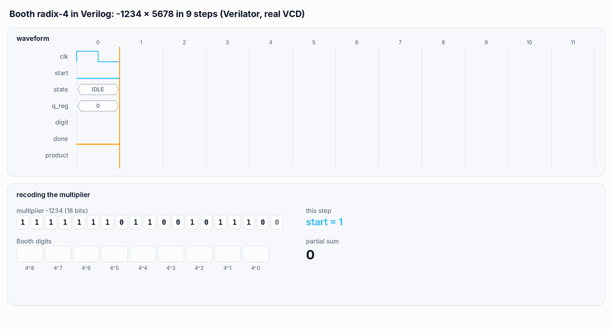

<p align="right">
  <a href="README.md"> <b>English</b></a>
  &nbsp;|&nbsp;
  <a href="README.pl.md"> Polski</a>
</p>

<a href="#see-it-in-action">
  <picture>
    <source media="(prefers-color-scheme: dark)" srcset="docs/banner-en-dark.svg" />
    <source media="(prefers-color-scheme: light)" srcset="docs/banner-en-light.svg" />
    
  </picture>
</a>

<p align="center">
  
  
  
  
  
</p>

<p align="center">
  <a href="#see-it-in-action"><b>Demo</b></a> &nbsp;·&nbsp;
  <a href="#how-it-works"><b>How it works</b></a> &nbsp;·&nbsp;
  <a href="#what-was-fixed"><b>Fixes</b></a> &nbsp;·&nbsp;
  <a href="#getting-started"><b>Getting started</b></a> &nbsp;·&nbsp;
  <a href="#project-structure"><b>Structure</b></a>
</p>

**Booth Radix-4 Modular Multiplier** is a project for the *Computer Organization and Architecture* course (*Organizacja i Architektura Komputerów*) at Wrocław University of Science and Technology. It multiplies two 18-bit signed numbers in two ways:

- **in hardware**: a sequential **Booth radix-4** multiplier written in **Verilog** (`rtl/BoothRadix4.v`), compiled to C++ by **Verilator** and driven clock by clock from a C++ testbench, with every signal saved to a VCD file;
- **in software**: the classic **Booth radix-2** algorithm in C++ on bit vectors.

The 36-bit product is then reduced **modulo 2^n − 3**, both with `%` and with the division-free folding a circuit would use (2^n ≡ 3, so H·2^n + L becomes 3H + L). One CMake project builds everything, also in CLion without installing Verilator, and `booth_sim test` checks both multipliers and both reductions against the exact result.

## See it in action

<p align="center">
  <picture>
    <source media="(prefers-color-scheme: dark)" srcset="docs/en/multiply-dark.gif" />
    <source media="(prefers-color-scheme: light)" srcset="docs/en/multiply-light.gif" />
    
  </picture>
</p>

<p align="center"><sub>One multiplication, −1234 × 5678, replayed from <code>docs/waveform.vcd</code>, the VCD file written by <code>booth_sim -1234 5678 16</code>. Top: the module's signals per clock cycle; the Booth digit is decoded from the three lowest bits of the product register. Bottom: the same digits on the multiplier bits and the partial sum Σ dᵢ · 5678 · 4ⁱ.</sub></p>

## Highlights

<table>
  <tr>
    <td width="25%" align="center"><h3>9</h3><sub>Booth steps for 18-bit numbers,<br/>against 18 in radix-2</sub></td>
    <td width="25%" align="center"><h3>11</h3><sub>clock cycles from <code>start</code><br/>to the product</sub></td>
    <td width="25%" align="center"><h3>100 169</h3><sub>pairs checked by <code>booth_sim test</code>,<br/>all three results correct</sub></td>
    <td width="25%" align="center"><h3>7</h3><sub>bugs fixed: two in the RTL,<br/>five in the C++ and the build</sub></td>
  </tr>
</table>

- **Real RTL simulation.** The Verilog module is not rewritten in C++: Verilator turns `rtl/BoothRadix4.v` into a C++ model, and `BoothRadix4Sim` toggles its clock, drives `start` and waits for `done`, like a testbench.
- **Waveforms.** Every hardware multiplication can be saved to a VCD file, with all internal registers, for GTKWave or any other viewer.
- **Two reductions modulo 2^n − 3.** The reference `%` and the folding 3H + L, compared on every test.
- **One command checks everything.** `booth_sim test` runs 169 edge pairs (0, ±1, ±2, ±3, the 18-bit limits and their neighbours) and 100 000 random ones; `ctest` runs it too.

## How it works

### The Verilog module

`BoothRadix4` has a parameter `N` (18) and the ports `mplier`, `mcand`, `start`, `clk`, `n_reset` (synchronous, active low), `done` and `product` (2N bits). Inside there is a two-state FSM:

| Clock edge | State before the edge | What happens |
|---|---|---|
| 1 | IDLE, `start = 1` | the multiplicand goes to `mcand_reg`, the multiplier to the low half of the product register, the accumulator is cleared |
| 2 to 10 | BUSY, `q_reg` = 0 to 8 | the three lowest bits (two multiplier bits and the bit shifted out last) select a Booth digit; the accumulator gets ±Mcand or ±2·Mcand, and the register shifts right arithmetically by 2 |
| 11 | BUSY, `q_reg` = 9, `done = 1` | the product register is copied to `product`, the FSM returns to IDLE |

| Bits | 000 | 001 | 010 | 011 | 100 | 101 | 110 | 111 |
|---|---|---|---|---|---|---|---|---|
| Digit | 0 | +1 | +1 | +2 | −2 | −1 | −1 | 0 |

Radix-4 recoding handles two multiplier bits per step, so an N-bit multiplication takes N/2 steps instead of N.

### The C++ side

| Part | What it does |
|---|---|
| `hw::BoothRadix4Sim` | the testbench: resets the module, sets the inputs, pulses `start`, clocks until `done` and sign-extends the 36-bit `product`; optionally writes a VCD file |
| `Booth` | radix-2 Booth on bit vectors: the pair (Q₀, Q₋₁) picks A − M, A + M or nothing, then A:Q:Q₋₁ shifts right; 18 iterations |
| `Modulo` | M = 2^n − 3 for n from 2 to 40: `applyModulo` with `%`, `reduce` by folding 3H + L until the value has n bits, then subtracting M if needed |
| `main` | menu, one-shot mode and the self-test |

## What was fixed

The original project ran, but several of its results were wrong. Every case below was checked by building the original code with Verilator:

| # | Problem | Original result | Now |
|---|---|---|---|
| 1 | **The accumulator in the Verilog module was one bit too narrow.** It had N+1 bits, and with the multiplicand −2^17 the digit −2 adds +2^18, which does not fit. The product register now has 2N+2 bits. | 2 × −131072 = −786 432 | −262 144 |
| 2 | **Negative numbers went into the 18-bit ports unmasked.** Verilator does not cut input values to the port width, so the upper bits of a negative `int` leaked into the product register and negative multipliers gave wrong results. | −1 × 1 = 8 190 | −1 |
| 3 | **The product was printed as an unsigned 36-bit number.** | 1234 × −5678 = 68 712 470 084 | −7 006 652 |
| 4 | **The modulo got the product cast to `int`** (36 bits into 32), and `1 << n` overflowed from n = 31. | 131071² mod 65533 = 65 522 | 25 |
| 5 | **The C++ Booth returned only the low half.** Its registers had 32 bits and the result was read from Q only, so any product above 2^31 was wrong; A and M also had no room for −M when M is the most negative value. Now A and M have n+1 bits and the result is A:Q. | 131071 × 131071 = −262 143 | 17 179 607 041 |
| 6 | **The build did not work.** `CMakeLists.txt` verilated `verilog/top.v` and listed nine Verilog files that are not in the repository, with paths to one computer; `build_and_run.sh` started with `cd C:`. The new CMake builds the Verilator model from `generated/` with any C++ compiler, or regenerates it with `verilate()` when Verilator is installed. | | opens in CLion |
| 7 | **The timing compared different things**: the hardware time covered 300 half cycles of simulation with the VCD writing, the software time one call. Now the program reports clock cycles (11) and iterations (18), and the times are labelled as simulation time. | | |

Other changes: the inputs are validated (−131072 to 131071, n from 2 to 40) and wrong input is asked again instead of looping forever; the menu has a third option that runs both methods and the exact product side by side, and a fourth that runs the self-test; `sc_time_stamp.cpp`, `lib/libverilated.a` (29 MB) and the build directories are gone from the repository.

## Getting started

<p align="center">
  
</p>

### CLion (Windows, nothing to install)

Open the folder in CLion and run `booth_sim`. That is all: the default toolchain with the bundled MinGW is enough.

Verilator is needed only to turn `rtl/BoothRadix4.v` into C++. That C++ model is already in `generated/VBoothRadix4`, together with the Verilator 5.020 runtime it needs in `third_party/verilator` (16 files, about 0.5 MB), so CMake compiles the hardware simulation like any other C++ code. The CMake log says `Model z generated/VBoothRadix4 i runtime Verilatora 5.020 z third_party/`.

### After changing the Verilog

The model in `generated/` has to be regenerated, which needs Verilator. On Windows it comes with [MSYS2](https://www.msys2.org/) (`pacman -S mingw-w64-ucrt-x86_64-verilator` in the UCRT64 terminal), on Linux with `apt install verilator`. When CMake finds Verilator (in `PATH`, `VERILATOR_ROOT`, `C:\msys64\ucrt64` or `C:\msys64\mingw64`), it regenerates the model from `rtl/` on every build (`Verilator 5.x: model generowany z rtl/BoothRadix4.v`). To update the files in `generated/` for others, run the `regenerate_model` target:

```bash
cmake --build build --target regenerate_model
```

If `rtl/BoothRadix4.v` changes and `generated/` is not updated, CMake prints a warning: it compares the file with the SHA-256 saved in `generated/rtl.sha256`.

### Linux or WSL

```bash
sudo apt install verilator cmake g++
cmake -S . -B build -DCMAKE_BUILD_TYPE=Release
cmake --build build
ctest --test-dir build              # self-test
```

### Running

```bash
./build/booth_sim                   # menu: 1 Verilog, 2 C++, 3 both + exact product, 4 self-test, 5 exit
./build/booth_sim -1234 5678 16     # one multiplication, both methods, modulo 2^16 - 3, waveforms in waveform.vcd
./build/booth_sim test              # self-test, 100 000 random pairs
./build/booth_sim test 1000000      # more pairs
```

In the menu every hardware multiplication writes `dump_1.vcd`, `dump_2.vcd` and so on to the working directory. They open in [GTKWave](https://gtkwave.sourceforge.net/) or any other VCD viewer. Messages in the program are in Polish.

## Project structure

```
.
├── rtl/
│   └── BoothRadix4.v           # sequential Booth radix-4 multiplier, parameter N = 18
├── src/
│   ├── main.cpp                # menu, one-shot mode, self-test
│   ├── hw/                     # BoothRadix4Sim: Verilator testbench (clock, start, done, VCD)
│   ├── sw/                     # Booth: radix-2 Booth on bit vectors
│   ├── modulo/                 # Modulo: % and folding 3H + L for 2^n - 3
│   └── util/                   # BinaryUtils: conversions to and from bit vectors
├── generated/VBoothRadix4/     # C++ model generated by Verilator 5.020 from rtl/ (rtl.sha256: which version)
├── third_party/verilator/      # Verilator runtime needed to compile the model (LGPL-3.0)
├── tools/regenerate_model.cmake
├── docs/                       # waveform.vcd (the example above), README visuals (EN / PL, light / dark)
└── CMakeLists.txt              # model from generated/, or verilate() when Verilator is installed
```

<details>
<summary><b>Notes on the code</b></summary>
<br/>

- `third_party/verilator` is Verilator's own code under its own license (LGPL-3.0 or Artistic-2.0), not this repository's; the model in `generated/` is output of Verilator and belongs with the RTL.
- After the fix the module was also verilated with `N = 8` and checked on all 65 536 pairs of 8-bit numbers; that check is not part of the repository.
- `N` must be even: the counter counts N/2 steps and the module has no step for a single leftover bit.
- The `done` signal is combinational and lasts one cycle; the product register stays valid until the next `start`.
- In the last BUSY cycle the FSM still computes one more step into the product register; it does not affect `product`, which is copied from the register before that step.
- The time per multiplication in the self-test (about 0.7 µs for the simulation and 0.8 µs for the C++ Booth on bit vectors) says how fast the simulation and the C++ code are, not how fast the circuit would be.

</details>

---

<p align="center">
  <sub>Wrocław University of Science and Technology · Computer Organization and Architecture · Grzegorz Sienkiewicz</sub>
</p>
