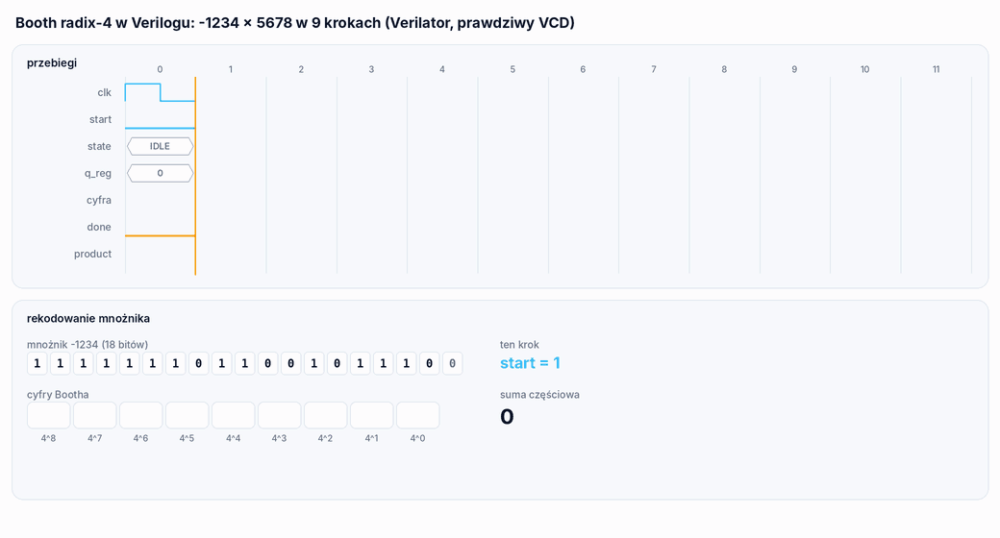

<p align="right">
  <a href="README.md"> English</a>
  &nbsp;|&nbsp;
  <a href="README.pl.md"> <b>Polski</b></a>
</p>

<a href="#zobacz-jak-działa">
  <picture>
    <source media="(prefers-color-scheme: dark)" srcset="docs/banner-pl-dark.svg" />
    <source media="(prefers-color-scheme: light)" srcset="docs/banner-pl-light.svg" />
    
  </picture>
</a>

<p align="center">
  
  
  
  
  
</p>

<p align="center">
  <a href="#zobacz-jak-działa"><b>Demo</b></a> &nbsp;·&nbsp;
  <a href="#jak-to-działa"><b>Jak to działa</b></a> &nbsp;·&nbsp;
  <a href="#co-zostało-poprawione"><b>Poprawki</b></a> &nbsp;·&nbsp;
  <a href="#uruchomienie"><b>Uruchomienie</b></a> &nbsp;·&nbsp;
  <a href="#struktura-projektu"><b>Struktura</b></a>
</p>

**Booth Radix-4 Modular Multiplier** to projekt z kursu *Organizacja i Architektura Komputerów* na Politechnice Wrocławskiej. Mnoży dwie 18-bitowe liczby ze znakiem na dwa sposoby:

- **sprzętowo**: sekwencyjna mnożarka **Bootha radix-4** napisana w **Verilogu** (`rtl/BoothRadix4.v`), przetłumaczona na C++ przez **Verilatora** i sterowana cykl po cyklu z testbencha w C++, z zapisem wszystkich sygnałów do pliku VCD;
- **programowo**: klasyczny algorytm **Bootha radix-2** w C++ na wektorach bitów.

36-bitowy iloczyn jest potem redukowany **modulo 2^n − 3**, zarówno operatorem `%`, jak i bez dzielenia, tak jak zrobiłby to układ (2^n ≡ 3, więc H·2^n + L zamienia się w 3H + L). Jeden projekt CMake buduje wszystko, także w CLion bez instalowania Verilatora, a `booth_sim test` sprawdza obie mnożarki i obie redukcje z dokładnym wynikiem.

## Zobacz, jak działa

<p align="center">
  <picture>
    <source media="(prefers-color-scheme: dark)" srcset="docs/pl/multiply-dark.gif" />
    <source media="(prefers-color-scheme: light)" srcset="docs/pl/multiply-light.gif" />
    
  </picture>
</p>

<p align="center"><sub>Jedno mnożenie, −1234 × 5678, odtworzone z <code>docs/waveform.vcd</code>, czyli pliku VCD zapisanego przez <code>booth_sim -1234 5678 16</code>. U góry: sygnały modułu w kolejnych cyklach zegara; cyfra Bootha jest odczytana z trzech najmłodszych bitów rejestru iloczynu. Na dole: te same cyfry na bitach mnożnika i suma częściowa Σ dᵢ · 5678 · 4ⁱ.</sub></p>

## Najważniejsze

<table>
  <tr>
    <td width="25%" align="center"><h3>9</h3><sub>kroków Bootha dla liczb 18-bitowych,<br/>wobec 18 w radix-2</sub></td>
    <td width="25%" align="center"><h3>11</h3><sub>cykli zegara od <code>start</code><br/>do iloczynu</sub></td>
    <td width="25%" align="center"><h3>100 169</h3><sub>par sprawdzonych przez <code>booth_sim test</code>,<br/>wszystkie trzy wyniki poprawne</sub></td>
    <td width="25%" align="center"><h3>7</h3><sub>poprawionych błędów: dwa w RTL,<br/>pięć w C++ i budowaniu</sub></td>
  </tr>
</table>

- **Prawdziwa symulacja RTL.** Moduł Verilog nie jest przepisany na C++: Verilator zamienia `rtl/BoothRadix4.v` na model w C++, a `BoothRadix4Sim` przełącza jego zegar, podaje `start` i czeka na `done`, jak testbench.
- **Przebiegi.** Każde mnożenie sprzętowe może trafić do pliku VCD, ze wszystkimi rejestrami wewnętrznymi, do obejrzenia w GTKWave albo innej przeglądarce.
- **Dwie redukcje modulo 2^n − 3.** Wzorcowy `%` i zwijanie 3H + L, porównywane w każdym teście.
- **Jedno polecenie sprawdza wszystko.** `booth_sim test` uruchamia 169 par brzegowych (0, ±1, ±2, ±3, granice zakresu 18 bitów i ich sąsiedzi) i 100 000 losowych; `ctest` uruchamia go też.

## Jak to działa

### Moduł Verilog

`BoothRadix4` ma parametr `N` (18) i porty `mplier`, `mcand`, `start`, `clk`, `n_reset` (synchroniczny, aktywny stanem niskim), `done` i `product` (2N bitów). W środku jest automat o dwóch stanach:

| Zbocze zegara | Stan przed zboczem | Co się dzieje |
|---|---|---|
| 1 | IDLE, `start = 1` | mnożna trafia do `mcand_reg`, mnożnik do młodszej połowy rejestru iloczynu, akumulator jest zerowany |
| 2 do 10 | BUSY, `q_reg` = 0 do 8 | trzy najmłodsze bity (dwa bity mnożnika i bit wysunięty ostatnio) wybierają cyfrę Bootha; akumulator dostaje ±Mcand albo ±2·Mcand, a rejestr przesuwa się arytmetycznie w prawo o 2 |
| 11 | BUSY, `q_reg` = 9, `done = 1` | rejestr iloczynu jest kopiowany do `product`, automat wraca do IDLE |

| Bity | 000 | 001 | 010 | 011 | 100 | 101 | 110 | 111 |
|---|---|---|---|---|---|---|---|---|
| Cyfra | 0 | +1 | +1 | +2 | −2 | −1 | −1 | 0 |

Rekodowanie radix-4 obsługuje dwa bity mnożnika na krok, więc mnożenie N-bitowe zajmuje N/2 kroków zamiast N.

### Część w C++

| Część | Co robi |
|---|---|
| `hw::BoothRadix4Sim` | testbench: resetuje moduł, ustawia wejścia, podaje impuls `start`, taktuje do `done` i rozszerza znak 36-bitowego `product`; opcjonalnie zapisuje plik VCD |
| `Booth` | Booth radix-2 na wektorach bitów: para (Q₀, Q₋₁) wybiera A − M, A + M albo nic, potem A:Q:Q₋₁ przesuwa się w prawo; 18 iteracji |
| `Modulo` | M = 2^n − 3 dla n od 2 do 40: `applyModulo` operatorem `%`, `reduce` przez zwijanie 3H + L, aż wartość ma n bitów, potem odejmowanie M, jeśli trzeba |
| `main` | menu, tryb jednego mnożenia i test automatyczny |

## Co zostało poprawione

Oryginalny projekt się uruchamiał, ale część wyników była błędna. Każdy przypadek poniżej sprawdziłem, budując oryginalny kod Verilatorem:

| # | Problem | Wynik oryginału | Teraz |
|---|---|---|---|
| 1 | **Akumulator w module Verilog był o bit za wąski.** Miał N+1 bitów, a przy mnożnej −2^17 cyfra −2 dodaje +2^18, które się nie mieści. Rejestr iloczynu ma teraz 2N+2 bity. | 2 × −131072 = −786 432 | −262 144 |
| 2 | **Liczby ujemne trafiały do 18-bitowych portów bez maskowania.** Verilator nie przycina wartości wejść do szerokości portu, więc starsze bity ujemnego `int` przeciekały do rejestru iloczynu i ujemne mnożniki dawały złe wyniki. | −1 × 1 = 8 190 | −1 |
| 3 | **Iloczyn był wypisywany jako 36-bitowa liczba bez znaku.** | 1234 × −5678 = 68 712 470 084 | −7 006 652 |
| 4 | **Modulo dostawało iloczyn rzutowany na `int`** (36 bitów do 32), a `1 << n` przepełniało się od n = 31. | 131071² mod 65533 = 65 522 | 25 |
| 5 | **Booth w C++ zwracał tylko młodszą połowę.** Rejestry miały 32 bity, a wynik był czytany tylko z Q, więc każdy iloczyn powyżej 2^31 był błędny; A i M nie miały też miejsca na −M, gdy M jest najmniejszą wartością. Teraz A i M mają n+1 bitów, a wynik to A:Q. | 131071 × 131071 = −262 143 | 17 179 607 041 |
| 6 | **Budowanie nie działało.** `CMakeLists.txt` werylatował `verilog/top.v` i wymieniał dziewięć plików Verilog, których nie ma w repozytorium, ze ścieżkami z jednego komputera; `build_and_run.sh` zaczynał się od `cd C:`. Nowy CMake kompiluje model Verilatora z `generated/` dowolnym kompilatorem C++ albo generuje go na nowo przez `verilate()`, gdy Verilator jest zainstalowany. | | działa w CLion |
| 7 | **Pomiar czasu porównywał różne rzeczy**: czas sprzętowy obejmował 300 półokresów symulacji z zapisem VCD, programowy jedno wywołanie. Teraz program podaje cykle zegara (11) i iteracje (18), a czasy są opisane jako czas symulacji. | | |

Inne zmiany: wejścia są sprawdzane (od −131072 do 131071, n od 2 do 40), a błędna wartość jest pobierana ponownie, zamiast zapętlać program; menu ma trzecią opcję, która uruchamia obie metody i pokazuje dokładny iloczyn, oraz czwartą z testem automatycznym; `sc_time_stamp.cpp`, `lib/libverilated.a` (29 MB) i katalogi budowania zniknęły z repozytorium.

## Uruchomienie

<p align="center">
  
</p>

### CLion (Windows, bez instalowania czegokolwiek)

Otwórz folder w CLion i uruchom `booth_sim`. To wszystko: wystarczy domyślny toolchain z dołączonym MinGW.

Verilator jest potrzebny tylko do zamiany `rtl/BoothRadix4.v` na C++. Ten model w C++ jest już w `generated/VBoothRadix4`, razem z potrzebnym mu runtime'em Verilatora 5.020 w `third_party/verilator` (16 plików, około 0,5 MB), więc CMake kompiluje symulację sprzętu jak każdy inny kod w C++. W logu CMake jest `Model z generated/VBoothRadix4 i runtime Verilatora 5.020 z third_party/`.

### Po zmianie kodu w Verilogu

Model w `generated/` trzeba wygenerować ponownie, a do tego potrzebny jest Verilator. Na Windows instaluje się go przez [MSYS2](https://www.msys2.org/) (`pacman -S mingw-w64-ucrt-x86_64-verilator` w terminalu UCRT64), na Linuksie przez `apt install verilator`. Gdy CMake znajdzie Verilatora (w `PATH`, `VERILATOR_ROOT`, `C:\msys64\ucrt64` albo `C:\msys64\mingw64`), generuje model z `rtl/` przy każdym budowaniu (`Verilator 5.x: model generowany z rtl/BoothRadix4.v`). Żeby zaktualizować pliki w `generated/` dla innych, uruchom cel `regenerate_model`:

```bash
cmake --build build --target regenerate_model
```

Jeśli `rtl/BoothRadix4.v` się zmieni, a `generated/` nie, CMake wypisze ostrzeżenie: porównuje plik ze skrótem SHA-256 zapisanym w `generated/rtl.sha256`.

### Linux albo WSL

```bash
sudo apt install verilator cmake g++
cmake -S . -B build -DCMAKE_BUILD_TYPE=Release
cmake --build build
ctest --test-dir build              # test automatyczny
```

### Użycie

```bash
./build/booth_sim                   # menu: 1 Verilog, 2 C++, 3 oba + dokładny iloczyn, 4 test, 5 wyjście
./build/booth_sim -1234 5678 16     # jedno mnożenie obiema metodami, modulo 2^16 - 3, przebiegi w waveform.vcd
./build/booth_sim test              # test automatyczny, 100 000 losowych par
./build/booth_sim test 1000000      # więcej par
```

W menu każde mnożenie sprzętowe zapisuje `dump_1.vcd`, `dump_2.vcd` i kolejne w katalogu roboczym. Otwierają się w [GTKWave](https://gtkwave.sourceforge.net/) albo innej przeglądarce VCD.

## Struktura projektu

```
.
├── rtl/
│   └── BoothRadix4.v           # sekwencyjna mnożarka Bootha radix-4, parametr N = 18
├── src/
│   ├── main.cpp                # menu, tryb jednego mnożenia, test automatyczny
│   ├── hw/                     # BoothRadix4Sim: testbench Verilatora (zegar, start, done, VCD)
│   ├── sw/                     # Booth: Booth radix-2 na wektorach bitów
│   ├── modulo/                 # Modulo: % i zwijanie 3H + L dla 2^n - 3
│   └── util/                   # BinaryUtils: konwersje do i z wektorów bitów
├── generated/VBoothRadix4/     # model C++ wygenerowany przez Verilatora 5.020 z rtl/ (rtl.sha256: z której wersji)
├── third_party/verilator/      # runtime Verilatora potrzebny do kompilacji modelu (LGPL-3.0)
├── tools/regenerate_model.cmake
├── docs/                       # waveform.vcd (przykład z animacji), grafiki do README (EN / PL, jasne / ciemne)
└── CMakeLists.txt              # model z generated/ albo verilate(), gdy jest Verilator
```

<details>
<summary><b>Uwagi do kodu</b></summary>
<br/>

- `third_party/verilator` to kod Verilatora na jego własnej licencji (LGPL-3.0 albo Artistic-2.0), nie na licencji tego repozytorium; model w `generated/` jest wynikiem działania Verilatora i należy do RTL.
- Po poprawce moduł został też zwerylatowany z `N = 8` i sprawdzony na wszystkich 65 536 parach liczb 8-bitowych; ten test nie jest częścią repozytorium.
- `N` musi być parzyste: licznik liczy N/2 kroków, a moduł nie ma kroku dla pojedynczego pozostałego bitu.
- Sygnał `done` jest kombinacyjny i trwa jeden cykl; `product` zostaje ważny do następnego `start`.
- W ostatnim cyklu BUSY automat liczy jeszcze jeden krok do rejestru iloczynu; nie wpływa to na `product`, który jest kopiowany z rejestru przed tym krokiem.
- Czas jednego mnożenia w teście (około 0,7 µs dla symulacji i 0,8 µs dla Bootha w C++ na wektorach bitów) mówi o szybkości symulacji i kodu w C++, a nie o szybkości układu.

</details>

---

<p align="center">
  <sub>Politechnika Wrocławska · Organizacja i Architektura Komputerów · Grzegorz Sienkiewicz</sub>
</p>
